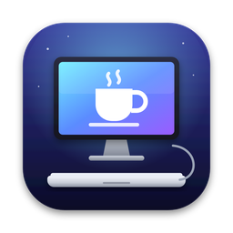

<p align="center">
  
</p>

<h1 align="center">Tapa Cerrada</h1>

<p align="center">
  Cierra la tapa de tu MacBook, conecta una pantalla y sigue trabajando.<br>
  Sin abrir el portátil, sin tocar nada.
</p>

<p align="center"><i>English summary at the bottom.</i></p>

---

## Qué hace

macOS solo usa el modo «tapa cerrada» si el Mac ya está enchufado y con pantalla
antes de cerrar la tapa. Si lo cierras primero, se duerme y te toca abrirlo otra vez.
Apps como Amphetamine lo arreglan a medias: hay que abrir el Mac y activar una sesión.

**Tapa Cerrada** vive en la barra de menús y lo decide sola:

| Situación | Qué hace |
|---|---|
| Hay una pantalla externa conectada | No se duerme, aunque cierres la tapa |
| Está con el cargador (opcional) | Puedes cerrar la tapa sin que se duerma |
| En batería, cierras la tapa sin pantalla | Te da un margen (5 min por defecto) para conectarla; si no, se duerme |
| En batería, tapa abierta y sin usarlo | Se duerme por inactividad como siempre (salvo vídeo o música) |
| Batería por debajo del mínimo (15 %) | Reposo normal |
| Cierras la app | Se restaura siempre el reposo normal |

El icono de la taza se rellena cuando el reposo está bloqueado.

## Instalación

Requiere **macOS 14 Sonoma o posterior**, en Apple Silicon o Intel.

### Opción A: descargar la app

1. Descarga el `.zip` de la última versión en [Releases](../../releases).
2. Descomprímelo y arrastra **Tapa Cerrada** a **Aplicaciones**.
3. Ábrela. Como la app no está firmada con una cuenta de desarrollador de Apple,
   macOS la bloqueará la primera vez:
   - Ve a **Ajustes del Sistema → Privacidad y seguridad** y pulsa **Abrir igualmente**, o
   - en Terminal: `xattr -dr com.apple.quarantine "/Applications/Tapa Cerrada.app"`

### Opción B: compilar desde el código

Necesitas las herramientas de desarrollo de Apple (`xcode-select --install`).

```bash
git clone https://github.com/amaestra205/tapa-cerrada.git
cd tapa-cerrada
./install.sh
```

### Primer arranque

- Te pedirá **tu contraseña una sola vez** (ver [Seguridad](#seguridad)).
- Se añade sola a los ítems de inicio de sesión. Si macOS avisa de un
  «ítem en segundo plano», acéptalo.

## Opciones del menú

- **Activado**: interruptor general.
- **Mantener despierto con el cargador**.
- **Margen con la tapa cerrada sin pantalla**: ninguno, 2, 5, 10, 15 o 30 min.
- **Reposo por inactividad (tapa abierta)**.
- **Dormir si la batería baja de…**
- **Despertar al conectar el cargador**: si tu Mac lo admite. Sirve para
  cuando ya estaba dormido del todo.
- **Dormir ahora**: mientras la app tiene el reposo bloqueado, «Reposo» del
  menú Apple no funciona; usa esta opción.
- **Ver registro**: `~/Library/Logs/TapaCerrada.log`.

## Seguridad

Para impedir el reposo con la tapa cerrada hay que cambiar el ajuste del sistema
`pmset disablesleep`, que requiere permisos de administrador. En lugar de ejecutar
un servicio con privilegios, la app instala (con tu contraseña, una vez) el fichero
`/etc/sudoers.d/tapacerrada`, que solo permite estos comandos exactos a tu usuario:

```
/usr/bin/pmset -a disablesleep 0
/usr/bin/pmset -a disablesleep 1
/usr/bin/pmset -a acwake 0
/usr/bin/pmset -a acwake 1
```

Puedes quitarlo cuando quieras desde el menú (**Quitar permiso de administrador…**)
o con `uninstall.sh`.

> ⚠️ Con la tapa cerrada el Mac se refrigera peor. No lo metas en una mochila con
> el reposo bloqueado durante mucho rato: para eso el margen es corto por defecto.

## Desinstalar

```bash
./uninstall.sh
```

O a mano: menú → *Quitar permiso de administrador…*, *Salir*, y borra la app de Aplicaciones.

## Desarrollo

```
Sources/            Código Swift (AppKit, IOKit, ServiceManagement)
  App.swift         Barra de menús, permisos e inicio de sesión
  Controller.swift  Lógica: cuándo bloquear el reposo y cuándo dormir
  Support.swift     Lectura de tapa, pantallas, batería; pmset; ajustes; registro
Resources/          Info.plist, icono y LaunchAgent
scripts/            build-app.sh (compila .app universal), package.sh (crea el .zip)
build.command       Doble clic: compila, instala y abre (desarrollo)
```

Publicar una versión: sube un tag y GitHub Actions compila y adjunta el `.zip`
a la release.

```bash
git tag v1.0.0 && git push origin v1.0.0
```

## Licencia

MIT. Mira [LICENSE](LICENSE).

---

## English summary

**Tapa Cerrada** ("closed lid") is a small menu bar app for macOS 14+ that lets you
close your MacBook's lid, plug in an external display and keep working, without
opening the laptop first. It keeps the Mac awake (`pmset disablesleep`) while an
external display or the charger is connected, gives you a short grace period on
battery to plug the display in, and otherwise falls back to normal sleep. It asks
for your admin password once to install a narrowly scoped sudoers rule.
Install from [Releases](../../releases) or run `./install.sh` from a clone.
The UI is in Spanish.
